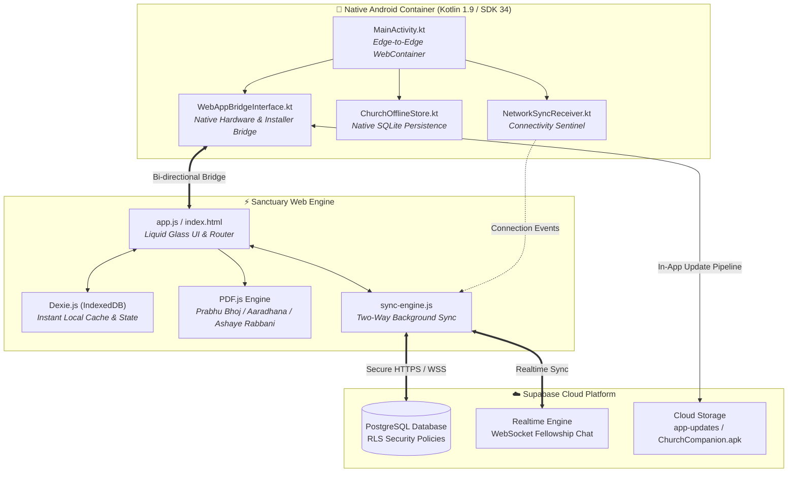

<div align="center">

  

  # ⛪ Church Companion
  ### *Church Companion & Liturgical Guide for the All Saints' Church - Church of North India (CNI)*

  [](https://github.com/iamemanual/CNI-Church-App/releases/tag/v2.1.9)
  [-3DDC84?style=for-the-badge&logo=android&logoColor=white)](https://developer.android.com)
  [](https://kotlinlang.org)
  [](https://supabase.com)
  [](https://developer.apple.com/design/)
  [](#-offline-first-dual-layer-persistence)

  <br />

  <p align="center">
    <b>Church Companion</b> is a companion application designed for the <b>Church of North India (CNI)</b> and <b>All Saints' Church</b>. Built with a hybrid offline-first architecture, it provides an immersive, edge-to-edge experience for worship, liturgical lectionary readings, multilingual hymn singing, sacramental services, and parish fellowship.
  </p>

  <p align="center">
    <a href="https://github.com/iamemanual/CNI-Church-App/releases/latest/download/ChurchCompanion.apk">
      
    </a>
    &nbsp;
    <a href="https://github.com/iamemanual/CNI-Church-App/releases">
      
    </a>
    &nbsp;
    <a href="#-key-features">
      
    </a>
  </p>

</div>

---

## 📲 Quick Download & Release Details

| Specification | Information |
| :--- | :--- |
| **Latest Release** | **`v2.1.9`** (Automated Build `4092043`) |
| **Package ID** | `com.allsaints.church` |
| **Direct APK Download** | [⬇️ **Download ChurchCompanion.apk** (43.28 MB)](https://github.com/iamemanual/CNI-Church-App/releases/download/v2.1.9/ChurchCompanion.apk) |
| **Target Android OS** | Android 14.0 (API Level 34) |
| **Minimum Android OS** | Android 8.0 Oreo (API Level 26) |
| **SHA-256 Checksum** | `9292b1a3274884eb143c3383de4c98f58b7bf290ef6e08b932a32e64a8fa6ecb` |

> [!TIP]
> **One-Tap In-App Updates**: If Church Companion is already installed on your device, you can update without manual browser downloads. Simply navigate to **Settings > App Update** to check for and install the latest build instantly.

---

## ✨ Key Features

### 📅 Liturgical Almanac & Three-Fold Lectionary
- **Full Liturgical Calendar**: Tracks all liturgical seasons (Advent, Christmas, Epiphany, Lent, Holy Week, Easter, Pentecost, Ordinary Time) with accurate liturgical colors (Purple, White/Gold, Red, Green).
- **Three Daily Services**: Prescribed Scripture lections for **Morning Prayer (Matins)**, **Holy Communion (Eucharist)**, and **Evening Prayer (Evensong)**.
- **Feasts, Fasts & Commemorations**: Automatic calculation of church feasts, solemnities, and saints' days aligned with the Church of North India calendar.

### 🎵 Multilingual Church Hymnal
- **Trilingual Hymnody**: Complete repertoire of hymns across English, Hindi (*Masihi Geet*), and Urdu scripts with romanized phonetic transliteration.
- **High-Speed Instant Search**: Search songs instantly by hymn number, opening lyric line, title, tune, or category.
- **Choir & Personal Setlists**: Bookmark hymns for Sunday services, choir rehearsals, and prayer meetings.
- **Audio & Vocal Accompaniments**: Playback support for organ tunes and vocal guides.

---

### 📖 Sacramental Orders & Liturgical Reader

<div align="center">
  <table>
    <tr>
      <td align="center" width="33%">
        <br />
        <b>Prabhu Bhoj (प्रभु भोज)</b><br />
        <sub>The Order for Holy Communion in Hindi</sub>
      </td>
      <td align="center" width="33%">
        <br />
        <b>Aaradhana (दैनिक आराधना)</b><br />
        <sub>Morning & Evening Common Prayer</sub>
      </td>
      <td align="center" width="33%">
        <br />
        <b>Ashaye Rabbani (عشائے ربانی)</b><br />
        <sub>Sacramental Order in Urdu</sub>
      </td>
    </tr>
  </table>
</div>

- **Built-in Offline PDF Engine**: Embedded PDF.js core delivers crisp rendering of official liturgical texts directly within the application without needing third-party readers.
- **Reader-Focused Typography**: Fluid scaling controls, night mode, and chapter navigation tailored for reading from the pews or the pulpit.

---

### 💬 Fellowship Community & Parish Channels
- **Parish Announcements & Prayer Wall**: Real-time communication channels for intercessory prayer requests, parish news, and ministry updates.
- **Role-Based Access Control (RBAC)**: Fine-grained security permissions (`Super Admin`, `Admin`, `Member`, `Visitor`) to maintain safe, constructive community interactions.
- **Parish Heritage & Timeline**: Interactive timeline celebrating church milestones and parish heritage from 1871 to 2026.

### ⚡ Offline-First Dual-Layer Persistence
- **Zero-Network Sanctuary Guarantee**: Engineered to function 100% offline within stone sanctuaries or areas with weak mobile reception.
- **Dual Persistence Architecture**:
  - **IndexedDB (`Dexie.js v4`)**: Powers instant in-browser UI queries, optimistic updates, and reactive components.
  - **SQLite Native Cache (`ChurchOfflineStore.kt`)**: Native Android database layer guaranteeing encrypted local storage and crash resilience.
- **Supabase Cloud Sync**: Two-way background synchronization engine with automatic conflict resolution as soon as network access resumes.

### 🔄 In-App APK Updates & Automated Version Controller
- **Automated Version Controller**: Integrated build engine tracks `version.properties`, auto-incrementing `versionCode` (+1) and semantic patch versions (`v2.1.x`) on every build.
- **One-Tap In-App Installation**: Downloads new packages and launches Android's package installer safely through scoped `FileProvider` APIs.
- **Automatic Storage Cleanup**: Automatically wipes temporary downloaded APK files post-installation to keep device storage clean.

### 🎨 Velvet Purple & Liquid Glass UI
- **True Edge-to-Edge**: Modern immersive layout with display cutout / notch adaptation and dynamic safe-area insets (`env(safe-area-inset-top)`).
- **Smooth 60/120fps Refresh**: Hardware-accelerated fluid spring animations (`cubic-bezier(0.16, 1, 0.3, 1)`) for buttery scrolling and screen transitions.
- **Deep Velvet Theme**: High-contrast AMOLED dark palette designed for reverent worship environments to save battery and avoid harsh screen glare.
- **Fluid Typography**: Balanced typography featuring Apple SF Pro Display, Cinzel serif headings, and Newsreader for scripture clarity.

---

## 🛠️ Architecture & Data Pipeline



---

## 📂 Project Structure

```text
CNI-Church-App/
├── app/
│   ├── version.properties                  # Automated version controller (versionCode & versionName)
│   ├── build.gradle.kts                    # Android build config (SDK 34, Min 26, auto-increment)
│   ├── proguard-rules.pro                  # R8 / ProGuard optimization rules
│   └── src/main/
│       ├── AndroidManifest.xml             # Android manifest & FileProvider configuration
│       ├── assets/                         # Sanctuary Web App assets
│       │   ├── index.html                  # Primary Edge-to-Edge sanctuary interface
│       │   ├── app_icon.png                # High-resolution application emblem
│       │   ├── church_bg.jpg               # Sanctuary backdrop
│       │   ├── covers/                     # Official liturgical book covers (PNG)
│       │   │   ├── prabhu_bhoj.png
│       │   │   ├── prata_sayan_kalin.png
│       │   │   └── ashaye_rabbani.png
│       │   ├── books/                      # Sacramental liturgical orders
│       │   ├── css/                        # Liquid Glass & Velvet Dark styling
│       │   ├── js/                         # app.js, supabase-sync.js, sync-engine.js
│       │   └── libs/                       # dexie.min.js, pdf.min.js, supabase.js
│       ├── java/com/allsaints/church/
│       │   ├── ChurchApplication.kt        # Application lifecycle & installer cleanup
│       │   ├── MainActivity.kt             # Edge-to-Edge WebView container
│       │   ├── WebAppBridgeInterface.kt    # Android-to-JS native bridge & APK installer
│       │   ├── ChurchOfflineStore.kt       # Native SQLite persistence layer
│       │   ├── ChurchSyncManager.kt        # Background sync orchestrator
│       │   ├── NetworkSyncReceiver.kt      # Broadcast network state receiver
│       │   └── engine/                     # Liturgical calendar & lectionary computation
│       └── res/                            # Android XML drawables, colors, & mipmap launcher icons
├── build.sh                                # Automated build, optimization & signing script
├── settings.gradle.kts                     # Gradle multi-project settings
├── build.gradle.kts                        # Root project build configuration
├── supabase_sync_engine_v1.sql             # Supabase schema, RLS policies, tables & triggers
└── README.md                               # Project documentation
```

---

## 🚀 Build & Development Guide

### Prerequisites
- **JDK**: Java Development Kit 17
- **Android SDK**: Build-Tools `34.0.0`, Platforms `android-34` (Minimum SDK `26`)
- **Gradle**: 8.7+ (or bundled Gradle wrapper)
- **Environment**: Compatible with Android Studio, Linux, macOS, and Termux

### 1. Clone the Repository
```bash
git clone https://github.com/iamemanual/CNI-Church-App.git
cd CNI-Church-App
```

### 2. Build via Android Studio
1. Launch **Android Studio**.
2. Select **Open** and choose the `CNI-Church-App` directory.
3. Allow Gradle to synchronize dependencies.
4. Connect an Android device or emulator running Android 8.0 (API 26) or higher.
5. Click **Run (Shift + F10)**.

### 3. Build via Command Line (CLI or Termux)
Automated build scripts are provided for headless and mobile development environments:

```bash
# Make the build script executable
chmod +x build.sh

# Compile a Debug APK
./build.sh debug

# Compile an Optimized, Signed Release APK
./build.sh release
```

The resulting signed release APK will be assembled at:
```text
app/build/outputs/apk/release/app-release.apk
```

---

## 🔏 Android Installation Guide

When downloading or updating the APK package manually:

1. Download [`ChurchCompanion.apk`](https://github.com/iamemanual/CNI-Church-App/releases/download/v2.1.9/ChurchCompanion.apk) from the [Latest Release Page](https://github.com/iamemanual/CNI-Church-App/releases/latest).
2. Tap the download notification or locate the APK in your device's **Files / Downloads** folder.
3. If prompted by Android, grant **Allow from this source** under *Install unknown apps*.
4. Select **Install** (or **Update** if updating an existing installation).
5. Launch Church Companion and begin worship!

---

## 🛡️ Security, Privacy & Integrity

- **Row Level Security (RLS)**: PostgreSQL tables on Supabase are protected with granular RLS policies, guaranteeing that parishioners only update their own profile records while retaining church-wide read access.
- **Offline Sandbox Isolation**: User preferences, personal bookmarks, and offline drafts are stored within isolated application sandbox storage.
- **Cross-Site Scripting (XSS) Sanitization**: All user inputs in fellowship channels are strictly sanitized via escaping engines before DOM injection.
- **Secure FileProvider Installation**: APK updates are verified and executed via scoped Android `content://` URIs, never exposing raw file paths to external applications.

---

## 🤝 Fellowship & Support

- **Repository**: [iamemanual/CNI-Church-App](https://github.com/iamemanual/CNI-Church-App)
- **Issue Tracker**: [GitHub Issues](https://github.com/iamemanual/CNI-Church-App/issues)
- **Parish**: [All Saints' Church](https://github.com/iamemanual/CNI-Church-App), Church of North India (CNI)

---

## 📜 Liturgical Heritage & License

Distributed for church parish, ministry, and diocesan worship use. Liturgical texts, lectionary tables, and hymns remain the heritage and intellectual property of their respective publishers, diocesan councils, and ecclesiastical authorities.

<div align="center">
  <sub>Emanual ♱ Built with faith for All Saints' Church & the Church of North India</sub>
</div>
