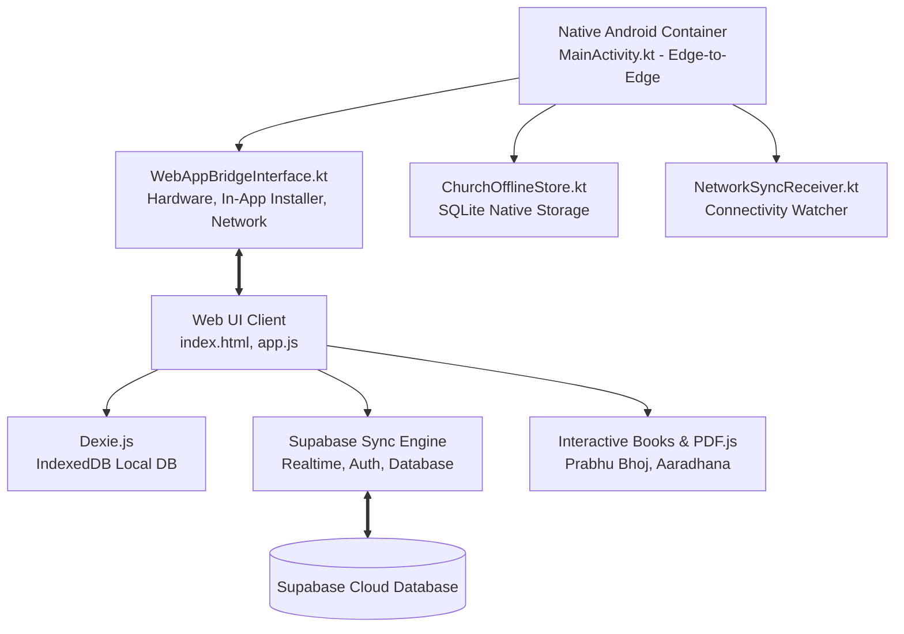

# ⛪ Church Companion (CNI Church App)

[](https://github.com/iamemanual/CNI-Church-App/releases/tag/v26.08.31)
[](https://developer.android.com)
[](https://kotlinlang.org)
[](https://supabase.com)
[](https://gradle.org)
[](#license)

> **Church Companion** is a sanctuary companion application designed for the **Church of North India (CNI)** and **All Saints' Cathedral**. Built with a hybrid offline-first architecture, it provides an immersive, edge-to-edge experience for worship, liturgical lectionary readings, multilingual hymn singing, sacramental services, and parish fellowship.

---

## 📲 Quick Download

Grab the latest official signed release APK:

| Version | Package | Direct Download |
| :--- | :--- | :--- |
| **`v26.08.31`** (Latest) | `com.allsaints.church` | [⬇️ **Download ChurchCompanion.apk** (43.27 MB)](https://github.com/iamemanual/CNI-Church-App/releases/download/v26.08.31/ChurchCompanion.apk) |

---

## ✨ Key Features

### 📅 Liturgical Almanac & Daily Lectionary
- **Full Church Calendar**: Follow liturgical seasons (Advent, Christmas, Epiphany, Lent, Easter, Pentecost, Ordinary Time) with standard liturgical colors.
- **Three-Service Daily Readings**: Daily Scripture appointed for Morning Prayer (Matins), Holy Communion (Eucharist), and Evening Prayer (Evensong).
- **Liturgical Feasts & Commemorations**: Automatic calculation of church feasts, solemnities, and saints' days.

### 🎵 Multilingual Church Hymnal
- **Bilingual Repertoire**: Complete collection of hymns in English, Hindi (*Masihi Geet*), and Urdu scripts with romanized phonetic transliteration.
- **Instant Search**: Find hymns instantly by number, title, opening line, season, or lyrics.
- **Favorites & Setlists**: Bookmark favorite hymns and organize custom service setlists for worship teams.
- **Audio & Notation Support**: Integrated playback support for audio recordings and vocal guides.

### 📖 Sacramental Orders & Liturgy Reader
- **Sacramental Service Books**: Interactive, reader-friendly liturgies:
  - **Prabhu Bhoj (प्रभु भोज)** — The Order for the Lord's Supper / Holy Eucharist in Hindi.
  - **Aaradhana (आराधना)** — Common worship and liturgy.
  - **Ashaye Rabbani (عشائے ربانی)** — Sacramental communion in Urdu script.
- **Integrated PDF Engine**: Embedded PDF.js reader allowing offline viewing of official liturgical prints with page jumping and zoom controls.

### 💬 Fellowship Community & Parish Channels
- **Parish Chat Channels**: Real-time communication for prayer requests, parish announcements, and ministry groups.
- **Role-Based Access Control (RBAC)**: Permission gates ensuring safe youth interaction and community moderation (Super Admin, Admin, Member, Visitor).
- **Parish Timeline & Heritage**: Historical timeline of All Saints' Cathedral and CNI milestones (1871–2026).

### ⚡ Offline-First Dual-Layer Persistence
- **Zero-Network Reliance**: Works 100% offline inside sanctuaries or areas with poor cellular reception.
- **Dual Persistence Architecture**:
  - **Dexie.js (IndexedDB)** for instant in-browser UI queries and local mutations.
  - **SQLite (`ChurchOfflineStore.kt`)** for native persistence, encrypted cache, and durability.
- **Supabase Cloud Sync**: Transparent background two-way synchronization with conflict resolution once connectivity is restored.

### 🔄 In-App APK Updates
- **Automatic Version Check**: Detects new GitHub releases and prompts users with clean update badges.
- **One-Tap In-App Installation**: Downloads and launches Android's package installer directly within the application using modern `FileProvider` APIs.
- **Auto-Cleanup**: Automatically cleans up temporary installer files post-installation to conserve device storage.

### 🎨 Velvet Purple & Liquid Glass UI
- **True Edge-to-Edge**: Seamless display with display cutout (notch) handling and translucent system bars.
- **Deep Velvet Theme**: Tailored for reverent worship environments with AMOLED high-contrast dark themes to preserve battery life and prevent distraction during services.
- **Fluid Typography**: Balanced layout featuring Apple SF Pro Display, Cinzel, and Newsreader serif typography.

---

## 🛠️ Architecture & Tech Stack



### Core Technologies
- **Android Shell**: Kotlin 1.9+, Android SDK 34 (Min SDK 26), AndroidX, ViewBinding, `enableEdgeToEdge`.
- **Hybrid Bridge**: Custom `WebAppBridgeInterface` exposing native package installation, system clipboard, file management, and connectivity events to the JavaScript layer.
- **Local Storage**: SQLite 3 (`church_offline.db`) + IndexedDB (`Dexie.js v4`).
- **Cloud Backend**: [Supabase](https://supabase.com) (PostgreSQL, Row Level Security, Realtime websockets, Storage).
- **UI & Presentation**: HTML5, Liquid Glassmorphism CSS, JavaScript (ES6+), PDF.js.

---

## 📂 Project Structure

```text
CNI-Church-App/
├── app/
│   ├── build.gradle.kts                        # Android build configuration (SDK 34, Min 26)
│   ├── proguard-rules.pro                      # R8 / ProGuard optimization rules
│   └── src/main/
│       ├── AndroidManifest.xml                 # Android Manifest & permissions
│       ├── assets/                             # Web application assets
│       │   ├── index.html                      # Primary Edge-to-Edge sanctuary interface
│       │   ├── manifest.json                   # Web app manifest
│       │   ├── css/                            # Liquid Glass & Velvet styles
│       │   ├── js/                             # app.js, supabase-sync.js, sync-engine.js
│       │   ├── libs/                           # dexie.min.js, pdf.min.js, supabase.js
│       │   └── assets/books/                   # Prabhu Bhoj, Aaradhana, Ashaye Rabbani
│       ├── java/com/allsaints/church/
│       │   ├── ChurchApplication.kt            # Application initialization & update cleanup
│       │   ├── MainActivity.kt                 # Edge-to-Edge WebView container
│       │   ├── WebAppBridgeInterface.kt        # Android-to-JS native bridge & APK installer
│       │   ├── ChurchOfflineStore.kt           # SQLite persistent storage engine
│       │   ├── ChurchSyncManager.kt            # Background sync worker
│       │   ├── NetworkSyncReceiver.kt          # Broadcast network state receiver
│       │   └── engine/                         # Native liturgical & lectionary engines
│       └── res/                                # Android XML layouts, drawables, app icons
├── build.sh                                    # Automated build & signing script
├── settings.gradle.kts                         # Gradle project structure
├── build.gradle.kts                            # Root build definition
├── supabase_sync_engine_v1.sql                 # Supabase schema, RLS policies & tables
└── README.md                                   # Project documentation
```

---

## 🚀 Getting Started & Building

### Prerequisites
- **Java**: JDK 17
- **Android SDK**: Build-Tools `34.0.0`, Platforms `android-34`
- **Gradle**: 8.7

### Clone the Repository
```bash
git clone https://github.com/iamemanual/CNI-Church-App.git
cd CNI-Church-App
```

### Build with Android Studio
1. Launch **Android Studio**.
2. Select **Open** and point to the cloned `CNI-Church-App` directory.
3. Allow Gradle to synchronize dependencies.
4. Connect an Android device or emulator (Android 8.0 / API 26 or higher).
5. Press **Run (Shift + F10)**.

### Build via Command Line (or Termux)
To build a signed release package:
```bash
# Debug build
./build.sh debug

# Signed Release build
./build.sh release
```
The resulting APK will be generated at `app/build/outputs/apk/release/app-release.apk` (or output directory).

---

## 🔏 APK Installation on Android

When downloading or updating the APK:
1. Download [ChurchCompanion.apk](https://github.com/iamemanual/CNI-Church-App/releases/download/v26.08.31/ChurchCompanion.apk).
2. Tap the downloaded notification or file in your file manager.
3. If prompted, grant **Install Unknown Apps** permission for your browser or file manager.
4. Tap **Install** or **Update**.

*Note: In-app updates will automatically trigger the installation prompt once you tap "Install Update" in the settings panel.*

---

## 🤝 Community & Support

- **Repository**: [iamemanual/CNI-Church-App](https://github.com/iamemanual/CNI-Church-App)
- **Issues & Requests**: [GitHub Issues](https://github.com/iamemanual/CNI-Church-App/issues)
- **Parish**: All Saints' Cathedral, Church of North India (CNI)

---

## 📜 License

Distributed under custom church parish and ministry usage terms. Liturgical texts and hymns remain the intellectual property of their respective publishers, committees, and diocesan authorities.
